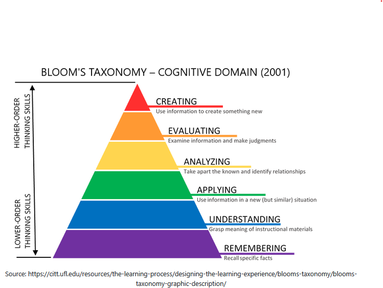

# Learning

With how revolutionary this new technology has become, it's only fitting to apply it intellectually and in a structured manner that prioritizes utility. 

That is the goal of this repository: 

### to allow anyone who wants to learn something and apply their knowledge to create novel and useful solutions to problems. 

The way I plan on accomplishing this is by leveraging the smartest thing humans have created (AI) in order to disseminate some of that knowledge and intelligence onto people.

1. clearly define what understanding means. what does it truly mean for a person to understand or know something?
2. take that definition and deconstruct it in a way that allows for programmatic iteration for each step of the learning process.
3. Create a method for each deconstructed step such that any user can apply it within any given learning context.

We will begin undertaking these three steps by defining understanding.
In _Understanding by Design_ by Grant Wiggins and Jay McTighe, the concept of understanding is defined as the ability for a person to apply knowledge towards a novel problem. I.e, to transfer the learned concept into solutions for problems never before seen by the student. **This is the definition I will be using, and thus the ultimate goal of this repository.**

I would also like to mention that the revised Bloom's Taxonomy also places creation of new ideas/solutions (synthesis) at the pinnacle of learning.

! 

The next step in our program is to deconstruct this definition into programmatic steps. What I mean by programmatic in this context is that the steps derived from this definition should be
