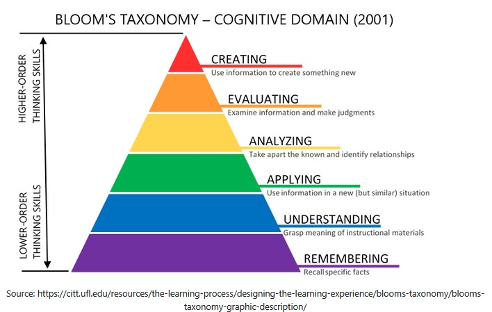

# Learning

With how revolutionary this new technology has become, it's only fitting to apply it intellectually and in a structured manner that prioritizes utility. 

That is the goal of this repository: 

### to allow anyone who wants to learn something to utilize AI to its fullest in achieving that goal. 

The way I plan on accomplishing this is by leveraging AI's teaching abilities to disseminate some of that knowledge and intelligence onto people. This will be done by:

1. Clearly defining what understanding means. What does it truly mean for a person to understand or know something?
2. take that definition and deconstruct it in a way that allows for programmatic iteration for each step of the learning process.
3. Create a method for each deconstructed step such that any user can apply it within any learning context.

We will begin undertaking these three steps by defining understanding.
In _Understanding by Design_ by Grant Wiggins and Jay McTighe, the concept of understanding is defined as the ability for a person to apply knowledge towards a novel problem. I.e, to transfer the learned concept into solutions for problems never before seen by the student. **This is the definition I will be using, and thus the ultimate goal of this repository.**

> I would also like to mention that the Bloom's revised Taxonomy also places creation of new ideas/solutions at the pinnacle of learning.

The next step is to deconstruct this definition into programmatic steps. What I mean by programmatic in this context is that the steps derived from this definition should be atomized in such a way as to have applicable algorithms applied to each step in order to accomplish our goal.

The structure is as follow:
1. define the prerequisite lower-order thinking step needed to attain the next, higher-order thinking step. (ex. memorization)
2. Apply AI to learning the subject at the level of this step. (ex. creating flashcards to memorize definitions.)
3. Test the student to ensure they are ready for the next higher-order thinking step (ex. test memorization before learning comprehension.)

This program can then be iterated until the student is at the final step, where he or she is given real problems to solve by applying all the previously learned knowledge.
